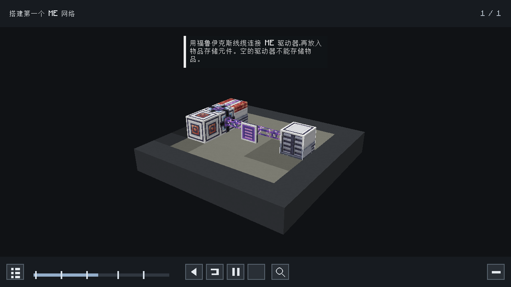
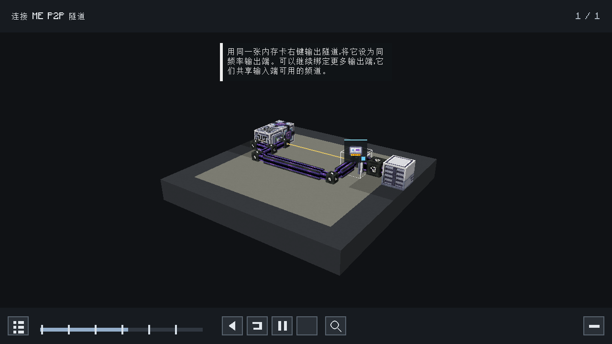

# AE2S Ponder 0.1.0 早期 0.4.0-alpha 验证档案

此档案对应旧 loader ID、旧安装包和 **0.4.0-alpha**；当前正式 **0.4.0** 发行验收见 [LEGACY-VERIFICATION.md](../LEGACY-VERIFICATION.md)。本页保留历史结果，不用于声明正式版兼容。

日期：2026-11-03。客户端基线为 [Cleanroom 官方 0.4.0-alpha](https://github.com/CleanroomMC/Cleanroom/releases/tag/0.4.0-alpha)。

## 结果

| 环境 | 结果 | 证据 |
| --- | --- | --- |
| 官方 CR 0.4.0-alpha 客户端，AE2S + 本附属 + Ponder + CraftTweaker | **PASS，551 项检查** | [报告](verification/0.1.0/client-with-ponder/report.json)、[启动日志](verification/0.1.0/client-with-ponder/startup.txt) |
| 官方 CR 0.4.0-alpha 客户端，AE2S + 本附属，未安装 Ponder | **PASS，5 项检查** | [报告](verification/0.1.0/client-without-ponder/report.json)、[启动日志](verification/0.1.0/client-without-ponder/startup.txt) |
| 官方 CR 0.4.0-alpha 专用服务器，安装 Ponder | **上游阻塞，未通过** | [结果](verification/0.1.0/server-with-ponder/result.json)、[日志](verification/0.1.0/server-with-ponder/startup.txt) |
| 官方 CR 0.4.0-alpha 专用服务器，未安装 Ponder | **上游阻塞，未通过** | [结果](verification/0.1.0/server-without-ponder/result.json)、[日志](verification/0.1.0/server-without-ponder/startup.txt) |
| 官方 CR 0.4.0-alpha 空服，无任何外部模组 | **复现相同上游异常** | [结果](verification/0.1.0/empty-server/result.json)、[日志](verification/0.1.0/empty-server/startup.txt) |
| Ponder 多物品关联诊断回归测试 | **7 项通过，0 失败** | [JUnit 原始报告](verification/0.1.0/ponder-diagnostic-tests.xml) |

**客户端基线验收通过；CR 0.4.0-alpha 专用服务器验收未通过。**
本附属是客户端教程，服务端无需安装。以上服务器失败保留为失败记录，没有使用其他 Cleanroom 版本的结果替代基线验收。

## 运行环境与产物

- Minecraft 1.12.2，官方 Cleanroom `0.4.0-alpha` universal。
- Java `25.0.5+8`，Linux x64，1280 × 720；实际创建 OpenGL 4.5 上下文。
- AE2S `1.1.0`：官方安装 jar，SHA-256 与 `dependency-lock.json` 一致。
- 本工作区 Ponder `1.4.0-cleanroom-alpha.1`：SRG 安装 jar，包含本次两项修正。
- CraftTweaker `4.1.20.698`：外部安装 jar，SHA-256 固定。
- 验证程序为单独重映射到 SRG 的开发模组，未包含在发布包中。

验证器从官方 MMC 实例配置构建运行环境，对配置包校验 SHA-256，对每项运行库和原版游戏文件校验配置中的 SHA-1。
它使用原版游戏 jar、官方加载器和该发布版本列出的运行库，**没有 userdev 的 SRG → MCP 运行时重映射**。
各次运行的模组及运行库摘要见 [带 Ponder 的环境清单](verification/0.1.0/client-with-ponder/runtime.json)和[不带 Ponder 的环境清单](verification/0.1.0/client-without-ponder/runtime.json)。

构建使用 CleanroomGradle `0.22.0` / Gradle `9.8.1` / Cleanroom `0.7.14-alpha` userdev。
官方 `0.4.0-alpha` 未提供此构建插件所需的 `cleanroom-userdev` 工件，因此编译工具链与实际基线运行环境分别配置；最低加载器声明保持 `0.4.0-alpha`。

| 安装文件 | 字节数 | SHA-256 |
| --- | ---: | --- |
| `AE2S-Ponder-1.12.2-0.1.0.jar` | 31014 | `e197fbf6138106c79e4381b076c6cdba58354c53484f59edfab2a9264e76f16e` |
| `Ponder-Cleanroom-1.12.2-1.4.0-cleanroom-alpha.1.jar` | 1181916 | `9eb72197a6b396a1f044b55b34c518b8c82ed99398b22a0a5e3010c965a5354c` |

源码包摘要另见 [artifacts.json](verification/0.1.0/artifacts.json)。归档时核对了报告中的安装包摘要与交付文件相同。

## 已执行的检查

1. FML 加载 AE2S 1.1.0 与本附属，确认实际 Cleanroom 版本；进入真实单人世界与内置服务器。
2. 条件 IMC 注册恰好八个稳定场景；物品入口均为真实 AE2S 注册物品，包括全部颜色的五类线缆。
3. 八个结构无未解析的方块和属性；逐项核对 TileEntity 类型、中央线缆与各面 multipart 部件。
4. 中英文分别执行八个场景的完整时间线，回退并重放；检查标题、讲解及 UI 打开，保存 16 张截图并检查 OpenGL 错误。
5. P2P 动画确实设置同频率输出角色；回退后恢复未绑定状态。
6. 在真实内置服务器世界摆放教程中的 P2P 拓扑，以创造能量元件替换储能元件提供确定性电源；等待网络稳定后，使用实际内存卡交互保存输入、绑定输出。
7. 实测石英纤维为承载网供电、两个隧道取得频道、承载网与来源控制器保持分离、远端驱动器通过输出端加入来源 ME 网络。
8. 在真实内置服务器世界中另行验证自动合成、处理样板和频道结构，确认驱动器通过可连接的面取得能量与频道；驱动器正面不用于网络连接。
9. 未安装 Ponder 时，本附属和 AE2S 正常启动并进入世界，不加载 Ponder 验证类。
10. 构建检查八个 NBT 的确定性再生成、43 段讲解引用，以及中英文各 59 个语言键的一致性。
11. 检查安装包：仅四个附属类、八个结构、中英文资源及元数据；Java class major version 为 69；没有验证程序、ServiceLoader 描述、AE2S / Ponder / Minecraft 实现类。

## Ponder 修正

- 相同 storyboard 实例与结构关联不同物品时，原诊断逻辑会报重复场景。现保留这些合法关联；重复关联同一物品、不同脚本或不同结构仍会报错，并增加回归测试。
- 原安装包声明了 `mixins.ponder.refmap.json`，构建时没有生成它。现通过 Mixin annotation processor 生成并打包四个 Mixin 的 MCP → SRG 映射；官方 CR 0.4.0-alpha 环境已实际加载并播放教程。

使用本附属时请配合本工作区重新构建的 Ponder 安装文件。

## 专用服务器阻塞

官方 CR `0.4.0-alpha` 在 `Loader.identifyMods` 调用 `KirinoCore.identifyMods` 时初始化 Kirino 客户端引导，触发：

```text
java.lang.NoClassDefFoundError: net/minecraft/client/entity/EntityPlayerSP
Caused by: java.lang.RuntimeException:
Attempted to load class bud/net.minecraft.client.entity.EntityPlayerSP for invalid side SERVER
```

同一官方运行环境、相同 Java 25、空 `mods/` 目录也复现该错误，发生在本附属初始化之前。
本次没有修改官方加载器、关闭该检查或把异常退出当成成功。日志虽然可能返回进程退出码 0，验证器仍要求 `FMLServerStarted` 的 PASS 报告才判定成功。
本地测试服仅绑定 `127.0.0.1`，使用临时端口；EULA 确认来自用户仅限本地测试服务器的授权。

## 重现命令

```bash
export JAVA_HOME=/path/to/jdk-25
./gradlew :build :reobfDevHarnessJar :ponder:reobfJar
python3 tools/verify-cleanroom.py client --with-ponder
python3 tools/verify-cleanroom.py client
python3 tools/verify-cleanroom.py server --with-ponder
python3 tools/verify-cleanroom.py server
./gradlew :ponder:test --tests net.createmod.ponder.foundation.diagnostic.PonderDiagnosticRegistryTest
```

基线目录位于 `run/cleanroom-0.4.0-alpha/<变体>/`，成功报告归档到 `build/reports/verification/`。
Gradle userdev 验证报告另放在 `build/reports/verification-userdev/<版本>/`，以免混入基线报告。
Linux 图形验证使用 `ALSOFT_DRIVERS=null`，避免本机 PipeWire 在语言切换、重建 OpenAL 上下文时的原生崩溃；本次不验收声音输出。

## 范围与截图

其他物品传输、合成和机器流程为 Ponder 虚拟世界中的分步讲解与脚本动画，没有声称实测了完整 ME 自动合成任务。
实际 ME 网络测试覆盖上文的 P2P 拓扑，以及自动合成、处理样板、频道结构中驱动器的供电与频道连接。未声明兼容原版 AE2、AE2UEL、现代官方 Ponder，或其他 AE2S 版本。

以下为官方 CR 0.4.0-alpha 使用安装 jar 的截图。其余场景的中英文原图均在同目录。




